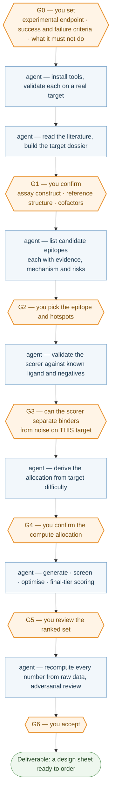

# my-academic-skills

Agent skills for research work. Each top-level directory is one skill that can
be installed, edited and verified on its own, using only the portable
`SKILL.md`, `references/`, `templates/` and `scripts/` layout with no
platform-specific machinery.

Works with Claude Code, Codex, opencode, and anything else that reads a
`SKILL.md` or an `AGENTS.md`. Python 3.8+ for the checks; nothing else.

[中文](README.md) · [Installation](docs/installation.md) · [Responsible use](RESPONSIBLE_USE.md)

## Skills

| Skill | What it does |
|---|---|
| [`binder-design-campaign/`](binder-design-campaign/) | Gated computational protein campaigns: de novo miniprotein binder design, structure and complex prediction, protein engineering |

---

## binder-design-campaign

### Where it comes from

In August 2026 Anthropic released everything behind their autonomous protein
binder design work: the technical report, measured binding data for 1,320
designs, and the protocol prompt that drove it.

That prompt runs to 16,281 words over 288 lines with no headings at all. It
writes the working knowledge of a binder design campaign as a verifiable
contract: which fields a target dossier must carry, what makes a scorer
trustworthy, when relaxation is permitted, which invariants a deliverable must
satisfy. Most of that knowledge lives in lab experience and rarely gets written
down in one place.

This skill is what came out of sorting the reusable parts of it.

### What it does not do

The prompt was written for one unattended 48-hour run, and it carries an
explicit rule: never ask the operator anything. That rule served an autonomy
experiment. It does not belong in day-to-day lab work.

So this skill inverts it, and consequently does not finish the job for you.
Every judgement an experienced designer would want to see becomes a gate: the
agent assembles the material, lays it out as a table, states a recommendation,
then stops and waits for your signature. It handles preparation, execution and
verification. You handle judgement.

That split is not caution. On the three targets in the published campaign that
yielded almost nothing, the in silico scores looked entirely normal beforehand
(below). A process that cannot see its own failure needs someone looking at it
before the money is spent.

### The workflow



G2 and G3 carry most of the risk. Epitope choice matters far more than model
choice. G3 is the one gate made mechanical: until `state/gates/<target>.json`
reads `PASS`, the submit gate refuses every production scoring job, and a
stated belief that the scorer works leaves it refusing.

### What was taken from the prompt

| In the source prompt | Here |
|---|---|
| Scoring instrument: multi-arm co-folding, ipSAE_min over both directions, sc_DockQ pose self-consistency, 4:1 weighted z-score | Kept. The formula lives in `scoring_policy.yaml` and nowhere else |
| Validation gate: fold recapitulation plus positive-control separation | Kept, promoted to human gate G3, with a hotspot-deleted perturbation control added |
| The four pre-scoring filters (novelty, liability, monomer foldability, structural plausibility) and their thresholds | Kept |
| Selection caps, relaxation ladder, diversity as a formal constraint | Kept, rewritten as `check_diversity.py` |
| Deliverable schema, null policy, write-time gate recompute | Kept, rewritten as `check_design_sheet.py` |
| Evidence discipline: state only what you ran, fetch every identifier, treat anomalies as bugs | Kept, in the non-negotiables loaded every turn |
| What a target dossier must record: oligomeric state, cofactors, assay construct, structure choice | Kept, expanded into `target-dossier-guide.md` and a template |
| Modal billing governor, `submit_gate.py`, Slack threading invariants, Drive upload coordinator | Dropped. Replaced by a four-verb backend contract with a first-class Slurm adapter |
| 48-hour window, zero-dormancy rule, heartbeat and watchdog singletons | Dropped. Only the in-job dead-man switch survives (`preflight.py`) |
| "Never ask the operator anything" | Inverted into seven gates |

What was dropped is roughly a third of the prompt, all of it bound to one
company's internal stack and unable to run anywhere else. The science was
reorganised into `references/` loaded on demand, and the main instruction file
came down to 159 lines.

### What was taken from elsewhere

| Source | What it contributed |
|---|---|
| [Adaptyv Bio protein-design-skills](https://github.com/adaptyvbio/protein-design-skills) (MIT) | The absolute cutoff table (pLDDT, ipSAE_min, PAE, shape complementarity, BUNS and more); the 50x campaign sizing rule of thumb; pass-rate diagnostic bands and the failure tree; per-method cost per design; the Nipah-G head-to-head hit rates |
| [Claude Science skills](https://github.com/HughYau/AcademicForge/tree/site-first/skills/claude-science) (MIT mirror) | Three ESMFold2 bring-up gotchas, including a default kernel backend that runs an order of magnitude slower than the paper; the de-vendoring approach in its `PORTABILITY.md` |
| Overath et al. 2025 meta-analysis (3,766 measured binders, doi:10.1101/2025.08.14.670059) | `ipSAE_min` as the best single in silico predictor, and the 0.61 cutoff |
| `writing-for-agents` | Document structure: context-budget tiers, progressive disclosure, mechanical rules written as scripts rather than prose |

The source prompt is relative throughout, ranking a pool against itself by
per-target z-score, and never says whether a number is any good on its own. The
first two entries supply that absolute side. Per-item attribution is in
[NOTICE.md](NOTICE.md).

### The fact the design is built around

In the published campaign, 1,320 designs were synthesised across 15 targets and
354 bound: a 27% hit rate, 49% among the top-ranked design per target. Three
targets produced almost nothing. Maltose-binding protein 0 of 90, the de novo
beta-barrel BBF-14 3 of 90, and 15-PGDH 1.

The co-folding scores gave no warning. Designs against the failed targets scored
about as well as designs against the targets that yielded many binders. Rescored
uniformly afterwards: within a target the ensemble ranked binders above
non-binders on 12 of 13 evaluable targets (mean average precision 0.52 against
0.31 by chance); across targets the median score rose with hit rate but not
steeply enough to have flagged the failures in advance; and among binders the
scores related only weakly to affinity.

So this skill treats in silico confidence as a filter, never an oracle, and
requires the substance of that sentence in every report it produces.

## Install

```bash
git clone https://github.com/SPYfighting/my-academic-skills.git
```

Claude Code / opencode, symlink the skill you want:

```bash
ln -s "$PWD/my-academic-skills/binder-design-campaign" \
      ~/.claude/skills/binder-design-campaign
```

Codex and other AGENTS.md readers: copy [`AGENTS.md`](AGENTS.md) into your
project root, or append its contents to an existing one.

Windows, project-local installs and verification steps are in
[docs/installation.md](docs/installation.md).

## Use

Ask in your own words:

> Design miniprotein binders against PD-L1. I have 4 A100s on a Slurm cluster
> and about a week.

It takes over at G0, asking about the experimental endpoint and the success and
failure criteria before it talks about pipelines. If it opens with a pipeline
instead, the trigger wording is not firing.

## Layout

```
my-academic-skills/
├── README.md · README.en.md      repository docs
├── AGENTS.md                     rules and version conventions for editing this repo
├── check.py                      runs every skill's self-check
├── docs/installation.md
└── binder-design-campaign/
    ├── SKILL.md                  the protocol, 159 lines, loaded every turn
    ├── workflows/                binder design · structure prediction · protein engineering
    ├── references/               scoring instrument · thresholds · validation gates
    │                             tool catalogue · dossiers · failure modes
    │                             deliverables · compute backends
    ├── checklists/               what to present at each gate
    ├── templates/                dossier · config · sheet schema · scoring policy · report
    ├── scripts/                  runnable checks, standard library only
    ├── examples/                 the fixture the scripts run against
    └── docs/                     design rationale · mapping to the source prompt
```

Where a file sits depends on when it needs to be read. `SKILL.md` is in context
every turn, so it is 159 lines. `references/` is read once, when a stage reaches
for it. `scripts/` never enters context at all; the agent runs it.

## Checks

```bash
python check.py
```

Runs every script against the fixture, then against a corrupted copy, and
asserts that the validators reject the corrupted one and say why. A check that
never fails is broken.

Adding a skill needs no change to `check.py`: it looks for each skill's
`scripts/selfcheck.py` by convention, and reports a skill without one as
unchecked rather than passing it silently.

## Scope and limits

This is in silico work and the protocol ends at the design sheet. Binding is
established experimentally, by you or a CRO, and nothing here substitutes for
that. Analysing returned assay data is a different task and does not run under
these gates.

Tool names, flags and licence facts were correct at their recorded date and must
be re-verified upstream before use. Where this repository and an upstream README
disagree, the README wins.

Dual use: see [RESPONSIBLE_USE.md](RESPONSIBLE_USE.md).

Not yet run end to end on a real campaign. What is verified is that the checks
catch what they claim to catch.

## Attribution and licence

Repository code and prose: MIT ([LICENSE](LICENSE)). Adapted from Anthropic's
CC-BY-4.0 prompt and technical report, and from MIT-licensed public skill
collections; per-item attribution in [NOTICE.md](NOTICE.md). Not affiliated with
or endorsed by any of them.

Citation format in [CITATION.cff](CITATION.cff), changes in
[CHANGELOG.md](CHANGELOG.md), contributions in
[CONTRIBUTING.md](CONTRIBUTING.md).
