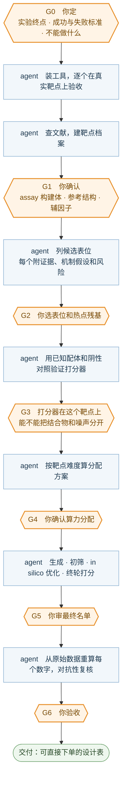

# my-academic-skills

科研用的 agent skill 集合。每个一级子目录是一个可独立安装、修改和验证的 skill，只用通用的 `SKILL.md`、`references/`、`templates/`、`scripts/`，不依赖任何平台专有机制。

可用于 Claude Code、Codex、opencode，以及任何读 `SKILL.md` 或 `AGENTS.md` 的 agent。除了跑检查脚本要用的 Python 3.8 以上，没有别的依赖。

[English](README.en.md) · [安装](docs/installation.md) · [负责任使用](RESPONSIBLE_USE.md)

## 当前技能

| Skill | 做什么 |
|---|---|
| [`binder-design-campaign/`](binder-design-campaign/) | 带人工关卡的蛋白计算 campaign：de novo 小蛋白 binder 设计、结构与复合物预测、蛋白工程改造 |

---

## binder-design-campaign

### 它从哪来

2026 年 8 月 Anthropic 公开了他们让 Claude 自主做蛋白 binder 设计的全部材料：技术报告、1,320 条设计的实测结合数据，以及驱动整件事的那份协议 prompt。

那份 prompt 有 16,281 词、288 行、零个小标题，是一整块连续散文。它把一次 binder 设计 campaign 的全部工作知识写成了一份可验证的任务合同：靶点档案要记哪些字段，打分器凭什么可信，什么时候允许放宽，交付物必须满足哪些不变量。这些经验平时散在各个实验室里，很少有人一次性写下来。

这个 skill 就是把那份 prompt 里可复用的部分整理出来的结果。

### 它不做什么

原 prompt 是给一次无人值守的 48 小时运行写的，里面有一条明确规定：不许向操作者提任何问题。那条规定服务于一个自主性实验，不适合搬进实验室日常。

所以这个 skill 反转了它，也因此不替你把活干完。凡是有经验的设计者会亲自过目的判断，都做成关卡：agent 把材料准备好、列成表、给出推荐，然后停下来等你签字。它负责准备、执行和核验，你负责判断。

这个分工不是出于谨慎。已发表的数据显示，在那三个几乎颗粒无收的靶点上，in silico 分数事先没有任何异常（见下）。一个看不出自己失败的流程，需要有人在花钱之前看几眼。

### 工作流程



G2 和 G3 承担了大部分风险。表位选得对不对，比用哪个模型影响大得多。G3 则是唯一被做成机器强制的关卡：`state/gates/<target>.json` 里不写 `PASS`，提交闸门就拒绝每一个生产打分作业，口头声称打分器可用不算数。

### 从原 prompt 吸收了什么

| 原 prompt 的内容 | 这里的处理 |
|---|---|
| 打分仪器：多臂 co-folding、ipSAE_min 双向取小、pose 自洽 sc_DockQ、4:1 加权 z 分 | 保留。公式写进 `scoring_policy.yaml`，全仓库只有这一处 |
| 验证门：靶点折叠复现加阳性对照分离度 | 保留，升格为人工关卡 G3，另加了热点删除的扰动对照 |
| 打分前四道滤器（新颖性、liability、单体可折叠、结构合理性）及其阈值 | 保留 |
| 选择上限、放宽阶梯、把多样性当正式约束 | 保留，改写成 `check_diversity.py` |
| 交付物 schema、空值策略、写入时重算门 | 保留，改写成 `check_design_sheet.py` |
| 证据纪律：只陈述做过的、标识符必须现查、异常先当 bug | 保留，放进每轮都加载的非协商条款 |
| 靶点档案该记什么：寡聚态、辅因子、assay 构建体、结构选择 | 保留，扩成 `target-dossier-guide.md` 和一份模板 |
| Modal 计费治理器、`submit_gate.py`、Slack 线程不变量、Drive 上传协调器 | 删掉。换成四个动词的后端契约，Slurm 为一等适配器 |
| 48 小时窗口、零休眠要求、心跳与看门狗单例 | 删掉。只留下作业内那个死人开关（`preflight.py`） |
| 「不许问操作者任何问题」 | 反转为七个关卡 |

删掉的部分约占原 prompt 三分之一，它们绑在一家公司的内部技术栈上，离开那个环境跑不起来。剩下的科学内容重组进按需加载的 `references/`，主指令压到 159 行。

### 还从别处吸收了什么

| 来源 | 拿到的东西 |
|---|---|
| [Adaptyv Bio protein-design-skills](https://github.com/adaptyvbio/protein-design-skills)（MIT） | 绝对阈值表（pLDDT、ipSAE_min、PAE、shape complementarity、BUNS 等）；规模测算的 50 倍经验法则；通过率诊断带和失败树；各方法单条设计成本；Nipah-G 竞赛的正面对比命中率 |
| [Claude Science skills](https://github.com/HughYau/AcademicForge/tree/site-first/skills/claude-science)（MIT 镜像） | ESMFold2 的三个上手陷阱，其中默认 kernel backend 未设会比论文慢一个数量级；`PORTABILITY.md` 的去厂商化思路 |
| Overath 等 2025 元分析（3,766 条实测结合物，doi:10.1101/2025.08.14.670059） | `ipSAE_min` 是最佳单一 in silico 预测指标，以及 0.61 这个阈值 |
| `writing-for-agents` | 文档结构方法：上下文预算分档、渐进披露、能机械核验的规则优先写成脚本 |

原 prompt 通篇是相对打分，也就是靶点内的 z 分，从不告诉你一个数字本身好不好。前两项补上了绝对的那一侧。逐项署名在 [NOTICE.md](NOTICE.md)。

### 整个设计围绕的那条事实

已发表的 campaign 里，15 个靶点合成了 1,320 条设计，354 条结合，命中率 27%；各靶点排名第一的设计中 49% 结合。但有三个靶点几乎什么都没出来：麦芽糖结合蛋白 0/90，de novo β-桶 BBF-14 3/90，15-PGDH 1 条。

co-folding 分数事先没给任何预警。失败靶点上的设计，分数和那些产出大量结合物的靶点上的设计差不多高。事后统一重算的结果是：在单个靶点内部，该集成在 13 个可评估靶点中的 12 个上能把结合物排在非结合物前面（平均精度均值 0.52，随机期望 0.31）；跨靶点看，中位分随命中率上升，但不足以提前标出失败；在结合物内部，分数与亲和力只有弱相关。

所以这个 skill 把 in silico 置信度当筛子，不当神谕（a filter, never an oracle），并要求这句话的实质出现在它产出的每一份报告里。

## 安装

```bash
git clone https://github.com/SPYfighting/my-academic-skills.git
```

Claude Code / opencode，软链你要用的那个 skill：

```bash
ln -s "$PWD/my-academic-skills/binder-design-campaign" \
      ~/.claude/skills/binder-design-campaign
```

Codex 及其他读 AGENTS.md 的 agent，把 [`AGENTS.md`](AGENTS.md) 复制进项目根目录，或把内容追加到已有文件。

Windows 安装、项目级安装和验证步骤见 [docs/installation.md](docs/installation.md)。

## 使用

用自己的话说需求就行：

> 帮我针对 PD-L1 设计小蛋白 binder。Slurm 集群上有 4 张 A100，大概一周时间。

它会从 G0 接管，先问实验终点、成功与失败标准，然后才谈流程。如果它上来就给你一套流水线方案，说明触发措辞没生效。

## 目录结构

```
my-academic-skills/
├── README.md · README.en.md      仓库说明
├── AGENTS.md                     agent 改这个仓库时的规则和版本约定
├── check.py                      跑所有 skill 的自检
├── docs/installation.md
└── binder-design-campaign/
    ├── SKILL.md                  主指令，159 行，每轮加载
    ├── workflows/                binder 设计 · 结构预测 · 蛋白工程
    ├── references/               打分仪器 · 绝对阈值 · 验证关卡 · 工具目录
    │                             靶点档案 · 失败模式 · 交付物 · 计算后端
    ├── checklists/               每个关卡该呈现什么
    ├── templates/                档案 · 配置 · 表格 schema · 打分策略 · 报告提纲
    ├── scripts/                  可运行检查，纯标准库
    ├── examples/                 脚本的测试夹具
    └── docs/                     设计理由 · 与原 prompt 的逐段对照
```

一份文件放在哪一层，取决于它什么时候需要被读到。`SKILL.md` 每轮都在上下文里，所以只有 159 行；`references/` 只在走到那一步时读一次；`scripts/` 永远不进上下文，agent 只运行它。

## 自检

```bash
python check.py
```

先用样例数据跑一遍全部脚本，再用故意损坏的副本跑一遍，断言校验脚本确实拒绝了损坏数据并说清了原因。一个永远不报错的检查脚本，本身就是坏的。

加新 skill 不用改 `check.py`。它按约定去找每个 skill 的 `scripts/selfcheck.py`，找不到就报告为未验证，不会静默通过。

## 适用范围和局限

这里做的是 in silico 工作，协议止于设计表。结合与否由你或 CRO 用实验确定，没有任何东西能替代那一步。分析回来的 assay 数据是另一件事，不在这些关卡下运行。

工具名称、参数和许可证信息只在其标注日期上正确，用之前须回上游核实。本仓库与上游 README 冲突时以 README 为准。

双重用途问题见 [RESPONSIBLE_USE.md](RESPONSIBLE_USE.md)。

还没有在真实 campaign 上端到端跑过。目前被验证的只有一件事：检查脚本确实能抓到它声称要抓的东西。

## 署名与许可

仓库代码和文字用 MIT（[LICENSE](LICENSE)）。改编自 Anthropic 以 CC-BY-4.0 发布的 prompt 和技术报告，以及若干 MIT 许可的公开 skill 集合，逐项出处在 [NOTICE.md](NOTICE.md)。与上述任何一方均无隶属关系，也未获背书。

引用格式见 [CITATION.cff](CITATION.cff)，改动记录见 [CHANGELOG.md](CHANGELOG.md)，参与贡献见 [CONTRIBUTING.md](CONTRIBUTING.md)。
